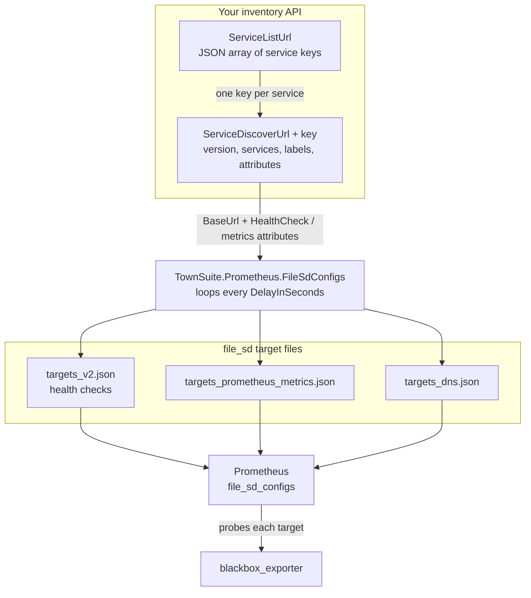

[](https://github.com/TownSuite/TownSuite.Prometheus.FileSdConfigs/actions/workflows/dotnet.yml)

[](https://github.com/TownSuite/TownSuite.Prometheus.FileSdConfigs/actions/workflows/test-report.yml)

# TownSuite.Prometheus.FileSdConfigs

A single self-contained executable that polls your own service-inventory endpoints and
continuously writes Prometheus [`file_sd_configs`](https://prometheus.io/docs/prometheus/latest/configuration/configuration/#file_sd_config)
target files — for blackbox health checks, Prometheus metrics scraping, and DNS probing.

Documentation site: [`jekyll_site/`](jekyll_site) (published via GitHub Pages).

## How it works



Every cycle each output file is written to `<path>.tmp` and then moved over the real file, so
Prometheus never reads a half-written file. Leaving an output path blank in `appsettings.json`
disables that output.

# Install

## Mac publish
```bash
dotnet publish -c Release -r osx-x64 -p:PublishReadyToRun=true --self-contained true -p:PublishSingleFile=true -p:EnableCompressionInSingleFile=true
```

## Linux publish
```bash
dotnet publish -c Release -r linux-x64 -p:PublishReadyToRun=true --self-contained true -p:PublishSingleFile=true -p:EnableCompressionInSingleFile=true
```

## Windows publish
```powershell
dotnet publish -c Release -r win-x64 -p:PublishReadyToRun=true --self-contained true -p:PublishSingleFile=true -p:EnableCompressionInSingleFile=true
```

## Runtime identifiers
If a different target is required, review https://docs.microsoft.com/en-us/dotnet/core/rid-catalog for a full listing.

Produces a single executable file __TownSuite.Prometheus.FileSdConfigs__.

# appsettings.json

Configure in appsettings.json file in the same folder as the executable.

__appsettings.json__ example
```json
{
  "Logging": {
    "LogLevel": {
      "Default": "Debug",
      "System": "Information",
      "Microsoft": "Information"
    }
  },
  "AppSettings": {
    "DelayInSeconds": 1800,
    "UserAgent": "TownSuiteSD/1.0 Mozilla/5.0 (Macintosh; Intel Mac OS X 10.15; rv:107.0) Gecko/20100101 Firefox/107.0",
    "OutputPath": "targets.json",
    "OutputPathV2": "targets_v2.json",
    "OutputPathPrometheusMetrics": "targets_prometheus_metrics.json",
    "OutputPathOpenTelemetry": "targets_open_telemetry_metrics.json",
    "OutputPathDns": "targets_dns.json",
    "HttpTimeoutInSeconds": 10,
    "SkipCertificateValidation": false
  },
  "Settings": [
    {
      "LookupUrl": "http host address and path or filepath",
      "AuthHeader": "[If SrcPath is a url and auth this field should be set to basic auth or a bearer token]",
      "AppendPaths": [
        "/metrics",
        "/api/status"
      ],
      "Labels": {
        "job": "test",
        "env": "dev"
      },
      "IgnoreList": [
        "https://example.townsuite.com"
      ]
    }
  ],
  "SettingsV2": [
    {
      "ServiceListUrl": "http host address and path or filepath that lists services",
      "ServiceDiscoverUrl": "http host address and path to lookup details for specific services",
      "AuthHeader": "[If the lookup is a url and requires auth this field should be set to basic auth or a bearer token]",
      "IgnoreList": [
        "https://example.townsuite.com"
      ],
      "LowercaseLabels": true
    }
  ]
}
```

## AppSettings

| Key | Example | Description |
| --- | --- | --- |
| `DelayInSeconds` | `1800` | Seconds to sleep between refresh passes. |
| `UserAgent` | string | `User-Agent` header sent on every lookup request. Omitted when blank. |
| `OutputPath` | `targets.json` | v1 output. Blank disables the v1 pass. |
| `OutputPathV2` | `targets_v2.json` | Health-check targets (v2). Blank disables it. |
| `OutputPathPrometheusMetrics` | `targets_prometheus_metrics.json` | Prometheus metric endpoints. Blank disables it. |
| `OutputPathOpenTelemetry` | `targets_open_telemetry_metrics.json` | OpenTelemetry metric endpoints. Blank disables it. |
| `OutputPathDns` | `targets_dns.json` | Host-only targets for DNS probing. Blank disables it. |
| `HttpTimeoutInSeconds` | `10` | Per-request HTTP timeout for all lookups. Omitted or `<= 0` falls back to 100 seconds. |
| `SkipCertificateValidation` | `false` | When `true`, accepts any TLS certificate. Only for internal hosts with self-signed certs. |

### When the configuration is wrong

Each output is independent: a path left blank disables just that output and the others still run.
The table below is measured behaviour, not intent — the `OutputPathOpenTelemetry` column stands for
any of the output-path settings.

| Situation | What happens |
| --- | --- |
| Key omitted, `null`, empty, or whitespace | That output is skipped for good. Nothing is written, no lookup runs for it, and the other outputs are unaffected. |
| Value is a number, e.g. `12345` | Configuration binds every value as a string, so this is a valid relative filename — you get a file literally named `12345`. |
| Value is an object or array | Binding fails and the process exits before the first pass, with `Cannot create instance of type 'System.String'`. |
| Path is in a directory that does not exist, or is not writable | The pass throws, `Crashing` is logged at critical, and the process exits `-1`. Outputs written earlier in that pass keep their files. Under systemd/NSSM this becomes a restart loop until the path is fixed. |
| `SettingsV2` section missing entirely | Startup fails with `Section 'SettingsV2' not found in configuration` — it is required even when only v1 sources are used. Use `"SettingsV2": []` for none. |
| `"SettingsV2": []` | Every v2 output is written as a valid empty document, `[]`. |
| A `null` entry, or an entry with no `ServiceListUrl` | The entry is logged and skipped; the remaining entries still produce targets. |
| `HttpTimeoutInSeconds` omitted or `<= 0` | Falls back to 100 seconds instead of failing on a zero timeout. |
| Instance has `OpenTelemetryUrl` but no `BaseUrl` | Instance is dropped — a path with nothing to append it to is not a target. |
| Instance has `BaseUrl` but no `OpenTelemetryUrl`, or an empty one | Instance is left out of that file only. If no instance qualifies the file is `[]`, which Prometheus reads as "no targets". |

## SettingsV2 (recommended)

One entry per inventory source; all entries are merged into the same output files.

| Key | Description |
| --- | --- |
| `ServiceListUrl` | Returns the list of service keys. May be an `http(s)` URL **or** a path to a local JSON file. |
| `ServiceDiscoverUrl` | Per-service detail lookup. The service key is appended directly to this string, so it normally ends in `=` or `/`. Must be an `http(s)` URL. |
| `AuthHeader` | Sent verbatim as the `Authorization` header (e.g. `Bearer abc123` or `Basic dXNlcjpwdw==`). |
| `IgnoreList` | Targets to drop. A target is skipped when it equals an entry **or starts with** an entry, so `https://service1` filters out every URL on that host. |
| `LowercaseLabels` | When `true`, label keys and values are trimmed and lowercased before being written. |

`Settings` (v1) is still read and still works, but it is marked obsolete — prefer `SettingsV2`.
See [v1 sources](#v1-sources-obsolete).

# Source JSON — what the endpoints must return

This is the JSON that *your* inventory service returns, not `appsettings.json`. Property names are
matched case-insensitively, so `BaseUrl`, `baseUrl`, and `baseurl` are all accepted.

## 1. `ServiceListUrl` → a JSON array of service keys

```json
[
  "Service1.Example",
  "Service2.Example",
  "Payments.Example"
]
```

Each entry is split on `.` and only the **first segment** is used, so `Service1.Example` becomes the
key `Service1`. That key is appended to `ServiceDiscoverUrl` to build the detail lookup:

```
https://inventory.example.com/discover?service=Service1
```

If `ServiceListUrl` does not start with `http` it is read from disk instead, with the same array
format.

## 2. `ServiceDiscoverUrl{key}` → the service's instances

```json
{
  "version": "1",
  "services": [
    {
      "name": "Service 1 — primary",
      "id": "3f6b2c1e-9a44-4f2f-9c3f-6e5b1c8d0a11",
      "labels": {
        "env": "prod",
        "job": "service1"
      },
      "attributes": {
        "BaseUrl": "https://service1.example.townsuite.com",
        "HealthCheck": "/healthz/ready",
        "PrometheusMetricsUrl": "/metrics",
        "DataCenter": "yyz1"
      }
    },
    {
      "name": "Service 1 — secondary",
      "id": "9c0a7b55-1d2e-4a88-b0a1-7c2f9e3d4b55",
      "labels": {
        "env": "prod",
        "job": "service1"
      },
      "attributes": {
        "BaseUrl": "https://service1b.example.townsuite.com",
        "HealthCheck": "/healthz/ready"
      }
    }
  ]
}
```

* `services` — one entry per running instance. Each instance becomes one object in the output file.
* `labels` — copied straight through to the Prometheus target labels. Use these for `job`, `env`, and
  anything else you want to group by.
* `attributes` — free-form. Recognized keys are listed below; unrecognized keys such as `DataCenter`
  are ignored, so you can return whatever else your inventory tracks.
* `version` — informational; it is read but not currently used for behaviour.

An instance without a `BaseUrl` attribute is skipped entirely.

### Recognized attributes

| Attribute | Used by | Description |
| --- | --- | --- |
| `BaseUrl` | all outputs | Scheme + host (+ optional base path) of the instance. **Required.** |
| `HealthCheck` | `targets_v2.json` | A health endpoint, appended to `BaseUrl`. |
| `HealthCheck_<suffix>` | `targets_v2.json` | Additional health endpoints. Any suffix, any number of them. |
| `ExtraHealthCheck` | `targets_v2.json` | Path or absolute URL that returns a JSON array of extra health endpoints. |
| `ExtraHealthCheck_Prefix` | `targets_v2.json` | Optional path inserted between `BaseUrl` and each endpoint returned by `ExtraHealthCheck`. |
| `PrometheusMetricsUrl` | `targets_prometheus_metrics.json` | Metrics path, appended to `BaseUrl`. |
| `OpenTelemetryUrl` | `targets_open_telemetry_metrics.json` | OpenTelemetry metrics path, appended to `BaseUrl`. Declaring it makes the instance a scrape target; instances without it are left out of that file. |

Slashes are normalized when a path is joined to `BaseUrl`, so `https://host/` + `/healthz` and
`https://host` + `healthz` both produce `https://host/healthz`.

## Listing multiple health endpoints for one site

There are three ways to give a single instance more than one health endpoint. They can be combined —
all of the resulting URLs are collected into that instance's single `targets` array, sorted, and
de-duplicated.

### a. `HealthCheck_<suffix>` — a fixed list, spelled out

`attributes` is a JSON object, so the keys must be unique. To list several endpoints, add a suffix
after `HealthCheck_`. The suffix is a label for you; the tool only looks at the `HealthCheck_`
prefix, and it accepts any number of them.

```json
{
  "version": "1",
  "services": [
    {
      "name": "Service 1",
      "id": "123",
      "labels": { "Env": "prod", "Job": "service1" },
      "attributes": {
        "BaseUrl": "https://service1.example.townsuite.com",
        "HealthCheck": "/healthz/ready",
        "HealthCheck_live": "/healthz/live",
        "HealthCheck_database": "/healthz/database",
        "HealthCheck_queue": "/healthz/queue"
      }
    }
  ]
}
```

Produces one target group with four endpoints on that host:

```json
[
  {
    "targets": [
      "https://service1.example.townsuite.com/healthz/database",
      "https://service1.example.townsuite.com/healthz/live",
      "https://service1.example.townsuite.com/healthz/queue",
      "https://service1.example.townsuite.com/healthz/ready"
    ],
    "labels": { "Env": "prod", "Job": "service1" }
  }
]
```

### b. `ExtraHealthCheck` — a list the site returns itself

Use this when the site knows its own endpoints and you do not want to re-deploy the inventory every
time one is added. The value is either a path on the site or an absolute URL:

```json
{
  "attributes": {
    "BaseUrl": "https://service1.example.townsuite.com",
    "HealthCheck": "/healthz/ready",
    "ExtraHealthCheck": "/healthz/extralookups"
  }
}
```

`GET https://service1.example.townsuite.com/healthz/extralookups` must return a JSON array of
endpoints:

```json
["hello/world", "world/hello"]
```

Each is appended to `BaseUrl`, giving:

```json
[
  {
    "targets": [
      "https://service1.example.townsuite.com/healthz/ready",
      "https://service1.example.townsuite.com/hello/world",
      "https://service1.example.townsuite.com/world/hello"
    ],
    "labels": { "Env": "prod", "Job": "service1" }
  }
]
```

The full contract for that lookup — and its failure behaviour — is in
[Extra health checks](#extra-health-checks--letting-a-site-list-its-own-endpoints) below.

### c. `ExtraHealthCheck_Prefix` — mount the returned list under a path

When the returned array holds names rather than full paths, add a prefix that sits between the base
URL and each returned endpoint:

```json
{
  "attributes": {
    "BaseUrl": "https://service1.example.townsuite.com",
    "HealthCheck": "/healthz/ready",
    "ExtraHealthCheck": "/healthz/extralookups",
    "ExtraHealthCheck_Prefix": "/healthz/ready/extras"
  }
}
```

With the same `["hello/world", "world/hello"]` response, the targets become:

```json
[
  {
    "targets": [
      "https://service1.example.townsuite.com/healthz/ready",
      "https://service1.example.townsuite.com/healthz/ready/extras/hello/world",
      "https://service1.example.townsuite.com/healthz/ready/extras/world/hello"
    ],
    "labels": { "Env": "prod", "Job": "service1" }
  }
]
```

### Notes on multiple endpoints

* One instance always yields **one** target group, sharing that instance's labels. Prometheus scrapes
  each URL in `targets` separately, so per-endpoint results stay distinguishable by `instance`.
* Two endpoints on **different** hosts belong to two `services` entries, each with its own `BaseUrl`.
  Do not try to put another host in a `HealthCheck_*` value — those values are always appended to the
  instance's `BaseUrl`.
* Duplicates are dropped, and so is any URL that is already a substring of a target in the same
  group. Prefer distinct, fully-specified paths (`/healthz/ready`, `/healthz/live`) over paths that
  nest inside one another.
* `IgnoreList` in `SettingsV2` is applied per target URL, so a single noisy endpoint can be filtered
  out without removing the whole instance.

## Extra health checks — letting a site list its own endpoints

`ExtraHealthCheck` inverts who owns the list. Instead of the inventory enumerating every endpoint,
the site exposes one endpoint that returns the health endpoints it manages, and the tool expands it
on every pass. Add or remove a health endpoint in the service and Prometheus follows on the next
cycle, with no inventory change and no restart.

### The contract

| | |
| --- | --- |
| **Declared by** | `ExtraHealthCheck` in an instance's `attributes` — one value, not a list. One lookup per instance. |
| **Request** | `GET`, no body. Sends the `SettingsV2` `AuthHeader` as `Authorization` and the configured `UserAgent`, under `HttpTimeoutInSeconds`. |
| **Response** | HTTP 2xx with a JSON array of strings. Nothing else is accepted — not an object, not an array of objects. |
| **Each string** | A path, joined to `BaseUrl` (or to `BaseUrl` + `ExtraHealthCheck_Prefix`). Leading slashes are optional. |

A minimal implementation on the service side:

```csharp
app.MapGet("/healthz/extralookups", () => new[]
{
    "/healthz/database",
    "/healthz/queue",
    "/healthz/upstream/billing"
});
```

### How one pass expands it

1. The instance's `HealthCheck` and `HealthCheck_*` values are joined to `BaseUrl` and added first.
2. The lookup URL is resolved: a value starting with `http` is used verbatim, anything else is joined
   to `BaseUrl`. So a path asks *the site itself* what it manages, while an absolute URL lets another
   service answer on its behalf.
3. The array comes back and each entry is joined to `BaseUrl`, or to `BaseUrl` +
   `ExtraHealthCheck_Prefix` when that attribute is set.
4. Everything lands in that instance's **single** `targets` array, sorted, sharing that instance's
   labels. `IgnoreList` is applied per URL, and a URL is dropped if it duplicates — or is a substring
   of — a target already in the group. Because the static endpoints are added first, a discovered
   endpoint loses that collision.

### Failure behaviour

The two failure modes are not equivalent, and one of them is lossy:

* A **non-success HTTP status** (404, 500, …) yields no endpoints and is skipped silently — nothing
  is logged. The instance keeps the targets it already collected from `HealthCheck` /
  `HealthCheck_*`.
* A **transport failure** (timeout, DNS, TLS) or a **malformed JSON body** is logged and drops the
  whole instance from that pass — including the `HealthCheck` targets already collected. Those
  targets disappear from the output file until a later cycle succeeds, and Prometheus stops probing a
  target that is no longer in the file, so the endpoint goes quiet instead of alerting.

If you rely on this attribute, alert on the absence of the probe rather than only on its result:

```yaml
- alert: HealthCheckTargetMissing
  expr: absent(probe_success{job="health_checks_service_discovery"})
  for: 15m
```

### Cost and trust

* The lookup runs **once per instance, per cycle**. Ten instances of a service means ten requests
  every `DelayInSeconds`; there is no caching, even when they all point at the same absolute URL.
* The `AuthHeader` configured for the inventory source is sent to the lookup URL as well. If that
  header is a shared credential, every host named by a `BaseUrl` — and any absolute URL you put in
  `ExtraHealthCheck` — receives it. Keep the lookup on hosts you already trust with it, or leave
  `AuthHeader` unset for sources that do not need it.
* The returned paths are appended to `BaseUrl` and never used as full URLs, so a compromised lookup
  cannot redirect probing at an unrelated host — but it can point the probe at any path on its own
  host. `IgnoreList` is the lever for suppressing specific paths.

## v1 sources (obsolete)

The v1 pass takes a flat list of hosts and appends the same paths to all of them. `LookupUrl`
returns (or a local file contains) a JSON array of base URLs:

```json
[
  "https://example.site1.townsuite.com",
  "https://example.site2.townsuite.com"
]
```

Every entry in `AppendPaths` is appended to every host. An `AppendPaths` entry that starts with
`http://` or `https://` is fetched instead, and must itself return a JSON array of paths:

```json
["/healthz/live", "/healthz/ready"]
```

All resulting URLs land in a single target group carrying the static `Labels` from that `Settings`
entry. `IgnoreList` here is an exact-match list of base URLs and target URLs.

# Output files

All outputs are standard Prometheus `file_sd` documents: an array of `{ "targets": [...], "labels": {...} }`.
In the v2 outputs the targets and label keys are sorted, so the files stay byte-stable between passes
as long as the discovered set has not changed.

| File | Setting | Contents |
| --- | --- | --- |
| `targets.json` | `OutputPath` | v1 output: every host × `AppendPaths`, with the static `Labels`. |
| `targets_v2.json` | `OutputPathV2` | Health-check endpoints per instance (`HealthCheck`, `HealthCheck_*`, `ExtraHealthCheck`). Feed this to the blackbox exporter. |
| `targets_prometheus_metrics.json` | `OutputPathPrometheusMetrics` | `BaseUrl` + `PrometheusMetricsUrl` per instance. |
| `targets_dns.json` | `OutputPathDns` | `scheme://host` only (path stripped), one group per service key, labelled `job=dns_prober` and `service=<key>`. |
| `targets_open_telemetry_metrics.json` | `OutputPathOpenTelemetry` | `BaseUrl` + `OpenTelemetryUrl` per instance. Only instances that declare `OpenTelemetryUrl` appear. |

__targets_v2.json__ example

```json
[
  {
    "targets": ["https://service1.example.townsuite.com/healthz/ready"],
    "labels": { "env": "prod", "job": "service1" }
  },
  {
    "targets": ["https://service2.example.townsuite.com/healthz/live"],
    "labels": { "env": "prod", "job": "service2" }
  }
]
```

__targets_open_telemetry_metrics.json__ example — only the instances that declare `OpenTelemetryUrl`

```json
[
  {
    "targets": ["https://service2.example.townsuite.com/metrics"],
    "labels": { "env": "prod", "job": "service2" }
  }
]
```

__targets_dns.json__ example

```json
[
  {
    "targets": ["https://service1.example.townsuite.com"],
    "labels": { "env": "prod", "job": "dns_prober", "service": "Service1" }
  }
]
```

# Setup as a windows service.

Download the executable


1. Copy it to a folder such as C:\promethues\TownSuite.Prometheus.FileSdConfigs 
2. Edit appsettings.json
3. Use [nssm](https://nssm.cc/) to configure it as a windows service.


```powershell
nssm install TownSuite.Prometheus.FileSdConfigs C:\prometheus\TownSuite.Prometheus.FileSdConfigs\TownSuite.Prometheus.FileSdConfigs.exe
nssm set TownSuite.Prometheus.FileSdConfigs AppDirectory C:\prometheus\TownSuite.Prometheus.FileSdConfigs
net start TownSuite.Prometheus.FileSdConfigs
```


# Setup as a Linux service

Extract the release and copy it to /opt/TownSuite.Prometheus.FileSdConfigs.

```
[Unit]
Description=The description of your service
# How to install:
# Copy YourProgramName binary to /opt/TownSuite.Prometheus.FileSdConfigs/TownSuite.Prometheus.FileSdConfigs
# Copy /etc/systemd/system/townsuite-prometheus-filesdconfigs.service
# systemctl enable townsuite-prometheus-filesdconfigs.service
# systemctl start townsuite-prometheus-filesdconfigs.service

[Service]
ExecStart=/opt/TownSuite.Prometheus.FileSdConfigs/TownSuite.Prometheus.FileSdConfigs
Restart=always
RestartSec=10                       # Restart service after 10 seconds if node service crashes
StandardOutput=syslog               # Output to syslog" >> /etc/systemd/system/your-program-service-name.service
StandardError=syslog                # Output to syslog" >> /etc/systemd/system/your-program-service-name.service
SyslogIdentifier=TownSuite.Prometheus.FileSdConfigs
WorkingDirectory=/opt/TownSuite.Prometheus.FileSdConfigs/

[Install]
WantedBy=multi-user.target
```

# prometheus.yml

This example configures the Prometheus metrics and rewrites both http and https and custom metric endpoints.   Secondly it configures prometheus to do health checks via the blackbox exporter.

```bash
sudo apt install prometheus
```

/etc/prometheus/prometheus.yml

```yaml
  - job_name: metrics_service_discovery
    scheme: http
    file_sd_configs:
    - files:
       - /opt/TownSuite.Prometheus.FileSdConfigs/targets_prometheus_metrics.json
    scrape_interval: 60s
    relabel_configs:
      - source_labels: [__address__]
        regex: '^(https?)://([^/]+)(/.*)?'
        target_label: __scheme__
        replacement: '${1}'
      - source_labels: [__address__]
        regex: '^(https?)://([^/]+)(/.*)?'
        target_label: __address__
        replacement: '${2}'
      - source_labels: [__address__]
        regex: '^(https?)://([^/]+)(/.*)?'
        target_label: __metrics_path__
        replacement: '${3}'
      - source_labels: [__metrics_path__]
        regex: '^$'
        replacement: '/metrics'
        target_label: __metrics_path__

  # OpenTelemetry endpoints — same relabelling as above, different file
  - job_name: open_telemetry_service_discovery
    scheme: http
    file_sd_configs:
    - files:
       - /opt/TownSuite.Prometheus.FileSdConfigs/targets_open_telemetry_metrics.json
    scrape_interval: 60s
    relabel_configs:
      - source_labels: [__address__]
        regex: '^(https?)://([^/]+)(/.*)?'
        target_label: __scheme__
        replacement: '${1}'
      - source_labels: [__address__]
        regex: '^(https?)://([^/]+)(/.*)?'
        target_label: __address__
        replacement: '${2}'
      - source_labels: [__address__]
        regex: '^(https?)://([^/]+)(/.*)?'
        target_label: __metrics_path__
        replacement: '${3}'

  # Health Checks via Blackbox Exporter
  - job_name: health_checks_service_discovery
    file_sd_configs:
    - files:
       - /opt/TownSuite.Prometheus.FileSdConfigs/targets_v2.json
    scrape_interval: 60s
    metrics_path: /probe
    params:
      module: [http_2xx]
    scheme: http
    relabel_configs:
      - source_labels: [__address__]
        target_label: __param_target
      - source_labels: [__param_target]
        target_label: instance
      - target_label: __address__
        replacement: 127.0.0.1:9115
```

The OpenTelemetry job is a plain scrape, not a blackbox probe: the file lists whatever
`OpenTelemetryUrl` resolved to, so an instance is scraped only if its inventory entry declares that
attribute. Point the job at an OTel Collector's `prometheus` receiver instead of Prometheus itself if
the collector owns the scrape.

Because every health endpoint is its own entry in `targets`, the `instance` label above ends up
holding the full probed URL — that is what keeps `/healthz/ready` and `/healthz/database` apart in
Prometheus and Alertmanager.

# Development

```bash
dotnet build
dotnet test
```

In `DEBUG` builds the configuration is loaded from `appsettings.Development.json` instead of
`appsettings.json`. Environment variables override file settings in both cases (for example
`AppSettings__DelayInSeconds=60`).

The unit tests in `TownSuite.Prometheus.FileSdConfigs.Tests` double as worked examples of the source
JSON — see `V2/SdTargetFileTest.cs` for the `HealthCheck_*` and `ExtraHealthCheck` cases.
